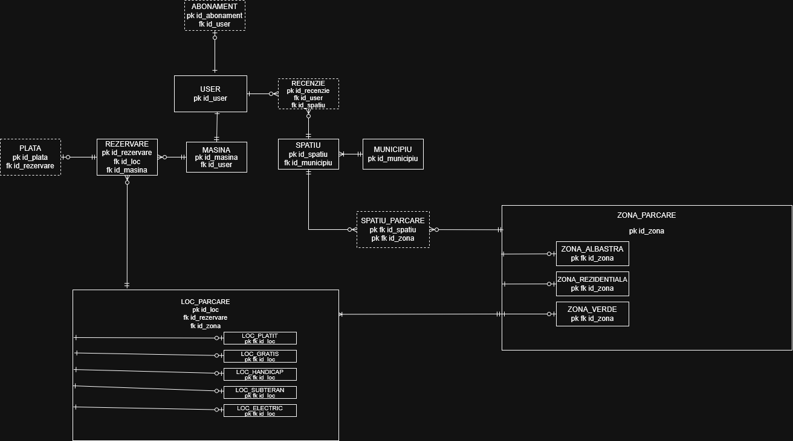
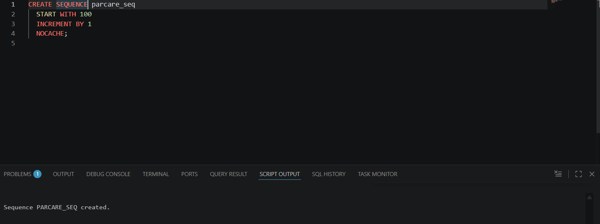

# Aplicatie pentru rezervarea locurilor de parcare


## 1. Descrierea proiectului

O aplicatie pentru rezervarea locurilor de parcare ofera utilizatorilor, in acest caz soferilor, oportunitatea de a cauta un spatiu liber pentru a isi parca masina. 

Fiecare masina identificata printr-un numar de inmatriculare poate sa ocupe doar un singur loc identificat printr-un id unic, de asemenea soferul isi ofera informatii de baza pentru a putea fi identificat ca unicul detinator al masinii. 

Locurile de parcare pot fi platite/gratuite, de asemenea pot fi normale, subterane de handicap sau pentru masini electrice. Un spatiu contine mai multe locuri de parcare si este identificat printr-o adresa, iar acesta are o capacitate maxima.

Desi este evident posibil ca un sofer sa detina mai multe masini, pentru conventie vom spune ca un sofer are o singura masina care ocupa un singur loc de parcare.

De asemenea, se vor oferi servicii care permite utilizatorului sa cunoasca exact care e rata pe un loc de parcare platit, deci trebuie sa avem o legatura cu municipiul care supravegheaza fiecare spatiu cu locuri de parcare.

Locuri de parcare de asemenea sunt separate in mai multe zone - zona albastra, zona galbena (rezidentiala), zona verde, care toate vor avea un efect asupra ratei locului de parcare. De exemplu zona verde are doar locuri de parcare gratis.

Pentru fiecare loc de parcare se va inregistra o rezervare care va avea o data si durata. Pentru fiecare rezervare vom avea si plata bazata pe durata.

In plus, se va permite lasarea recenziilor pentru a informa soferii unde se gasesc cele mai bune locuri de parcare, sau daca sunt posibile probleme cu spatiul respectiv. Se va mai si permite un abonament pentru utilizatori frecventi care ofera anumite bonusuri si reduceri.

## 2. Constrangeri

**Integritatea entitatilor**
- Toate tabelele au cheie primara diferita de NULL.


**Constrangeri de Unicitate**
- Toate cheile primare sunt unice.
In afara de chei primare, urmatoarele atribute trebuie sa fie marcate cu **UNIQUE**:
- nr_matricol (*Masina*), vrem un numar pe masina. Poate functiona ca o cheie primara teoretic dar id_masina este mai eficient.
- email (*User*), vrem sa putem identifica user-ul in mod unic.
- username (*User*), la fel ca mai sus, alternativa pentru logarea userului in cont.
- adresa (*Spatiu*), adresele se pot suprapune in viata reala dar nu vrem spatii duplicate.
- cod_fiscal (*Municipiu*), alt candidat pentru cheie primara pentru care folosim in schimb id_municipiu, dar in realitate este unic.
**Constrangeri de verificare**
Urmatoarele date trebuie sa fie valide, cu urmatoarele conditii:
- data_sfarsit > data_inceput (*Rezervare*), o rezervare nu se poate termina inainte sa inceapa.
- data_inceput >= CURRENT_DATE (*Rezervare*), nu putem incepe o rezervare in trecut.
- capacitate_maxima > 0 (*Spatiu*), un spatiu trebuie sa aiba macar un loc de parcare.
- suma >= 0 (*Plata*), nu putem avea plati negative.
- rating in (1,2,3,4,5) (*Recenzie*), avem un sistem pe stele.
- data_expirare > data_activare (*Abonament*), un abonament nu poate expira inainte sa fie activat.
- metoda_plata (*Plata*) in ('CARD', 'SMS', 'CASH', 'GIFTCARD'), doar aceste valori sunt valide; daca e NULL inseamna ca a fost loc gratis.
- nr_matricol (*Masina*) in format B-123-ABC sau AB-12-XYZ. Vom adauga un Regex.
- status (*Rezervare*) in ('Activa', 'Finalizata', 'Anulata').
**Constrangeri de suprapunere**
- disponibil (*LocParcare*) = TRUE pentru a putea fi rezervat. Doua masini nu pot inregistra acelasi loc de parcare.
- fk id_loc (*Rezervare*) trebuie sa fie NULL pentru ca o masina sa poata rezerva un loc. O masina nu poate inregistra doua locuri de parcare simultan.
- fk id_user (*Masina*) trebuie sa fie UNIQUE pentru conventia noastra de un user per masina. Astfel un user nu poate fi identificat dupa doua masini.
**Constrangeri FK**
- Daca un *USER* isi sterge contul se va face si stergere in cascada a tot istoricului, deci **CASCADE**. Alternativ, putem pune **RESTRICT** (nu isi poate sterge contul daca are o rezervare activa).
- Toate subentitatile necesita un pk+fk de la tabelul parinte; id_loc pentru subentitatile lui *LOC* si id_zona pentru subentitatile lui *ZONA*.
- fk id_user (*Abonament*) cu atributul 'activ' poate aparea o singura data <=> nu putem plati doua abonamente in acelasi timp.
**Constrangeri specifice**
- Daca avem un *LOC* in *ZONA_VERDE* => suma = 0 (*Plata*).
- Nr de inregistrari din *LOC* asociate lui id_spatiu nu trebuie sa depaseasca capacitate (*Spatiu*).
- Ne asiguram ca id_loc nu este simultan ocupat si in LocGratis si in LocPlatit. Un *LOC DE PARCARE* nu poate fi simultan gratis si platit.
- Doar o *MASINA* marcata ca Electric poate ocupa un LocElectric.
- Un *USER* poate lasa o *RECENZIE* daca si numai daca are cel putin o *REZERVARE* finalizata si platita: atributul status va identifica daca o rezervare este finalizata.


## 3. Entitati

*Entitatile* noastre, in format de entitate -> cheie_primara: 
- **LocParcare** -> id_loc
- **Masina** -> id_masina
- **User** -> id_user
- **Spatiu** -> id_spatiu
- **Rezervare** -> id_rezervare
- **Municipiu** -> id_municipiu
- **ZonaParcare** -> id_zona
- **Recenzie** -> id_recenzie
- **Abonament** -> id_abonament
- **Plata** -> id_plata

*Subentitatile* noastre, grupate dupa entitatea respectiva:
### LocParcare -> id_loc (pk+fk)
- **LocPlatit**
- **LocGratis**
- **LocSubteran**
- **LocHandicap**
- **LocElectric**
### ZonaParcare -> id_zona (pk+fk)
- **ZonaAlbastra**
- **ZonaRezidentiala**
- **ZonaVerde**

*Avem si tabelul asociativ **SpatiuParcare** -> __**id_spatiu+id_zona**__ (pk+fk).*

## 4. Relatii

- USER(1)-->ABONAMENT(1|0) Un *USER* **poate** avea un *ABONAMENT*; un *ABONAMENT* **trebuie** sa fie detinut de un *USER*.
- USER(1)-->RECENZIE(M|0) Un *USER* **poate** lasa o *RECENZIE*; o *RECENZIE* **trebuie** sa fie lasata de un *USER*.
- USER(1)-->MASINA(1|1) Un *USER* **trebuie** sa aibe o *MASINA*; o *MASINA* **trebuie** sa fie detinuta de un *USER*.
- MASINA(1|1)-->REZERVARE(M|0) O *MASINA* **poate** sa aibe mai multe *REZERVARI*; o *REZERVARE* **trebuie** sa aibe o *MASINA* inregistrata.
- REZERVARE(1|1)-->PLATA(1|0) O *REZERVARE* **poate** fi *PLATITA*; o *PLATA* trebuie sa fie inregistrata pentru o *REZERVARE*.
- REZERVARE(M|0)-->LOC_PARCARE(1|1) Mai multe *REZERVARI* **trebuie** inregistrate intr-un *LOC DE PARCARE*; un *LOC DE PARCARE* **poate** avea mai multe *REZERVARI*.
- RECENZIE(M|0)-->SPATIU(1|1) Mai multe *RECENZII* **trebuie** alocate unui *SPATIU*; un *SPATIU* **poate** avea mai multe *RECENZII*.
- SPATIU(M|1)-->MUNICIPIU(1|1) Mai multe *SPATII* **trebuie** monitorizate de un *MUNICIPIU*; un *MUNICIPIU* **trebuie** sa monitorizeze mai multe *SPATII*.
- SPATIU(M)-->ZONA_PARCARE(M) Mai multe *SPATII* **trebuie** sa aibe mai multe *ZONE DE PARCARE*; mai multe *ZONE DE PARCARE* **trebuie** sa se afle intr-un *SPATIU*.
- ZONA_PARCARE(1|1)-->LOC_PARCARE(M|1) O *ZONA DE PARCARE* **trebuie** sa aibe mai multe *LOCURI DE PARCARE*; mai multe *LOCURI DE PARCARE* **trebuie** sa se afle intr-o *ZONA DE PARCARE*.

## 5. Atribute

| ENTITATE | ATRIBUT | TIP DATE | CONSTRANGERI | VALORI IMPLICITE (daca sunt) |
|----------|---------|----------|--------------|------------------------------|
| **USERS** | id_user | INT | PK, Auto-increment | |
| | nume | VARCHAR(50) | | 'Guest' |
| | email | VARCHAR(100) | UNIQUE | |
| | username | VARCHAR(30) | | default_name+id_user |
| | nr_tel | VARCHAR(30) | | |
| | parola | VARCHAR(30) | | | 
| | data_reg | DATETIME | NOT NULL | CURRENT_TIMESTAMP |
| **MASINA** | id_masina | INT | PK | |
| | nr_matricol | VARCHAR(15) | NOT NULL, UNIQUE | ex. 'B123ABC' |
| | este_elec | BOOLEAN | NOT NULL | FALSE |
| | id_user | INT | FK, UNIQUE, NOT NULL | |
| **MUNICIPIU** | id_municipiu | INT | PK | |
| | nume | VARCHAR(255) | NOT NULL | |
| | judet | VARCHAR(50) | NOT NULL | |
| | cod_fiscal | VARCHAR(20) | NOT NULL, UNIQUE | |
| **SPATIU** | id_spatiu | INT | PK | |
| | adresa | VARCHAR(255) | NOT NULL, UNIQUE | |
| | capacitate | INT | NOT NULL, CHECK(capacitate>0) | |
| | id_municipiu | INT | FK, NOT NULL | | 
| **REZERVARE** | id_rezervare | INT | PK | |
| | data_inceput | DATETIME | NOT NULL, CHECK (data_inceput>=CURRENT_DATE) | |
| | data_sfarsit | DATETIME | NOT NULL, CHECK (data_sfarsit>data_inceput) | |
| | status | VARCHAR(20) | NOT NULL | 'Activa', 'Finalizata', 'Anulata' |
| | id_masina | INT | FK, NOT NULL | |
| | id_loc | INT | FK, NOT NULL | |
| **PLATA** | id_plata | INT | PK, Auto-increment | |
| | suma | DECIMAL(10,2) | CHECK(suma>=0) | |
| | data_plata | DATETIME | NOT NULL, CHECK(data_plata>=CURRENT_DATE) | |
| | metoda | VARCHAR(20) | | 'CARD', 'SMS', 'CASH', 'GIFTCARD' |
| | id_rezervare | INT | FK, UNIQUE, NOT NULL | |
| **ZONA** | id_zona | INT | PK | |
| | tarif_ora | DECIMAL(5,2) | NOT NULL | |
| **LOC_PARCARE** | id_loc | INT | PK | |
| | nr_loc | VARCHAR(10) | NOT NULL | |
| | disponibil | BOOLEAN | NOT NULL | TRUE |
| | id_zona | INT | FK, NOT NULL | |
| **SPATIU_PARCARE** | id_spatiu | INT | PK, FK | |
| | id_zona | INT | PK, FK | |
| **RECENZIE** | id_recenzie | INT | PK, Auto-increment | |
| | rating | INT | CHECK(rating BETWEEN 1 AND 5) | |
| | comentariu | VARCHAR(255) | | |
| | id_user | INT | FK, NOT NULL | |
| | id_spatiu | INT | FK, NOT NULL | |
| **ABONAMENT** | id_abonament | INT | PK, Auto-increment | |
| | tip | VARCHAR(20) | NOT NULL | 'Lunar', 'Anual' |
| | pret | DECIMAL(10,2) | NOT NULL | |
| | data_activare | DATE | NOT NULL, CHECK (data_activare>=CURRENT_DATE) | |
| | data_exp | DATE | NOT NULL, CHECK (data_exp>data_activare) | |
| | id_user | FK, INT | NOT NULL | |
| **LOC_PLATIT** | id_loc | INT | PK,FK | |
| | tarif_suplimentar | DECIMAL(10,2) | | |
| **LOC_GRATIS** | id_loc | INT | PK,FK | |
| | timp_max_loc | INT | NOT NULL | |
| **LOC_HANDICAP** | id_loc | INT | PK, FK | |
| | doc_necesar | VARCHAR(50) | NOT NULL | ex. Seria autorizatiei necesare | 
| **LOC_ELECTRIC** | id_loc | INT | PK, FK | |
| | putere | INT | NOT NULL, CHECK(putere>0) | |
| **LOC_SUBTERAN** | id_loc | INT | PK, FK | |
| | nivel | INT | CHECK (nivel<0) | |   
| **ZONA_VERDE** | id_zona | INT | PK,FK | |
| | timp_max | INT | NOT NULL, CHECK(timp_max<=120) | |
| **ZONA_ALBASTRA** | id_zona | INT | PK,FK | |
| | interval_max | INT | NOT NULL, CHECK(interval_max<=120) | |
| | penalizare | DECIMAL(5,2) | CHECK (penalizare>tarif_ora) | | 
| **ZONA_REZIDENTIALA** | id_zona | INT | PK, FK | |
| | id_permis_necesar | INT | NOT NULL | |
## 6. Diagrama ERD


## 7. Diagrama conceptuala




## 8. Scheme relationale

Format: ENTITATE (#**PK**, *FK*, #__**PK+FK**__, atribute)

1. USER (#**id_user**, nume, email, username, parola, data_reg, nr_tel)
2. MASINA (#**id_masina**, *id_user*, nr_matricol, este_elec)
3. MUNICIPIU (#**id_municipiu**, nume, judet, cod_fiscal)
4. SPATIU (#**id_spatiu**, *id_municipiu*, adresa, capacitate)
5. REZERVARE (#**id_rezervare**, *id_masina*, *id_loc*, data_inceput, data_sfarsit, status)
6. PLATA (#**id_plata**, *id_rezervare*, suma, data_plata, metoda)
7. ZONA (#**id_zona**, tarif_ora)
8. LOC (#**id_loc**, *id_zona*, nr_loc, disponibil)
9. SPATIU_PARCARE (#__**id_spatiu**__, #__**id_zona**__)
10. RECENZIE (#**id_recenzie**, *id_user*, *id_spatiu*, rating, comentariu)
11. ABONAMENT (#**id_abonament**, *id_user*, tip, pret, data_activare, data_exp)
12. LOC_PLATIT (#__**id_loc**__, tarif_suplimentar)
13. LOC_GRATIS (#__**id_loc**__, timp_max_loc)
14. LOC_HANDICAP (#__**id_loc**__, doc_necesar)
15. LOC_ELECTRIC (#__**id_loc**__, putere)
16. LOC_SUBTERAN (#__**id_loc**__, nivel)
17. ZONA_VERDE (#__**id_zona**__, timp_max)
18. ZONA_ALBASTRA (#__**id_zona**__, interval_max, penalizare)
19. ZONA_REZIDENTIALA (#__**id_zona**__, id_permis_necesar)


## 9. Normalizare


# FN1

**LOC_PARCARE**(#id_loc, *id_zona*, nr_loc, disponibil, tipuri)

'Tipuri' este un atribut multiplu deci neatomic ceea ce incalca FN1. Sa zicem ca poate fi de felul 'electric', 'subteran', etc.
Atunci pentru a rezolva vom separa in mai multe entitati separate ca subentitati ale lui LOC_PARCARE cu fk+pk id_loc
Adica:

**LOC_PARCARE**(#id_loc, *id_zona*, nr_loc, disponibil)

**LOC_SUBTERAN**(#*id_loc*, nivel)
**LOC_ELECTRIC**(#*id_loc*, putere)

# FN2

**REZERVARE**(#id_rezervare, #id_loc, data_inceput, data_sfarsit, status, nr_loc, disponibil)

Tabelul incalca FN2 deoarece avem urmatoarele dependente functionale:
-id_loc -> nr_loc, adresa (descrie doar locul si nu rezervare)
-id_rezervare -> data_inceput, data_sfarsit, status (descrie doar rezervarea si nu locul)

Asadar nr_loc si adresa_spatiu depind doar de o parte a cheii, nu de intreaga cheie compusa.
Normalizam in FN2 separand in doua tabele,

**LOC_PARCARE**(#id_loc, nr_loc, adresa)
**REZERVARE**(#id_rezervare, data_inceput, data_sfarsit, status) {eventual si FK-urile id_loc si id_masina}

# FN3

**REZERVARE**(#id_rezervare, data_inceput, data_sfarsit, *id_masina*, *id_loc*, *id_user*, nume_user, email_user, username_user)

Aici avem dependentele functionale:
-id_rezervare -> id_user
-id_user -> name_user, email_user, username_user

Inseamna ca name_user depinde de id_user care este un atribut non-cheie, ceea ce inseamna ca este o dependenta tranzitiva, incalca FN3.

Normalizam separand cu tabelul

**USERS**(id_user, name, email, username, [...])
si lasam in **REZERVARE** tot in afara de ce este acum in **USERS**.

## 10. Secventa pentru inregistrare

secventa pentru generarea identificatorilor folositi in inserarea datelor (nu neaparat pentru toate)

```sql CREATE SEQUENCE parcare_seq

  START WITH 100

  INCREMENT BY 1

  NOCACHE;
```



## 11. Crearea tabelelor si inserarea

# a. Creare tabele
```sql

DROP TABLE ZONA_VERDE;
DROP TABLE ZONA_ALBASTRA;
DROP TABLE ZONA_REZIDENTIALA;
DROP TABLE LOC_ELECTRIC;
DROP TABLE LOC_GRATIS;
DROP TABLE LOC_HANDICAP;
DROP TABLE LOC_PLATIT;
DROP TABLE LOC_SUBTERAN;
DROP SEQUENCE parcare_seq;
DROP TABLE PLATA;
DROP TABLE REZERVARE;
DROP TABLE SPATIU_PARCARE;
DROP TABLE RECENZIE;
DROP TABLE SPATIU;
DROP TABLE ABONAMENT;
DROP TABLE MASINA;
DROP TABLE MUNICIPIU;
DROP TABLE USERS;
DROP TABLE LOC_PARCARE;
DROP TABLE ZONA_PARCARE;

CREATE SEQUENCE parcare_seq
  START WITH 100
  INCREMENT BY 1
  NOCACHE;

CREATE TABLE MUNICIPIU (
    id_municipiu INT PRIMARY KEY,
    nume_municipiu VARCHAR2(50) NOT NULL,
    judet VARCHAR2(50) NOT NULL,
    cod_fiscal VARCHAR(20) UNIQUE NOT NULL
);

CREATE TABLE USERS (
    id_user INT PRIMARY KEY,
    nume VARCHAR2(50) DEFAULT 'Guest',
    email VARCHAR2(100) UNIQUE,
    username VARCHAR2(50),
    nr_tel VARCHAR2(30),
    parola VARCHAR2(30),
    data_reg TIMESTAMP DEFAULT CURRENT_TIMESTAMP NOT NULL
);


CREATE TABLE ZONA_PARCARE (
    id_zona INT PRIMARY KEY,
    tarif_ora NUMBER(5,2) NOT NULL
);

CREATE TABLE SPATIU (
    id_spatiu INT PRIMARY KEY,
    adresa VARCHAR2(255) UNIQUE NOT NULL,
    capacitate INT CHECK (capacitate > 0) NOT NULL,
    id_municipiu INT NOT NULL,
    CONSTRAINT fk_spatiu_muni FOREIGN KEY (id_municipiu) REFERENCES MUNICIPIU(id_municipiu)
);

CREATE TABLE MASINA (
    id_masina INT PRIMARY KEY,
    nr_matricol VARCHAR2(15) UNIQUE NOT NULL,
    este_elec NUMBER(1) DEFAULT 0 NOT NULL,
    id_user INT UNIQUE NOT NULL,
    CONSTRAINT fk_masina_user FOREIGN KEY (id_user) REFERENCES USERS(id_user) ON DELETE CASCADE
);

CREATE TABLE LOC_PARCARE (
    id_loc INT PRIMARY KEY,
    nr_loc VARCHAR2(10) NOT NULL,
    disponibil NUMBER(1) DEFAULT 1 NOT NULL,
    id_zona INT NOT NULL,
    CONSTRAINT fk_loc_zona FOREIGN KEY (id_zona) REFERENCES ZONA_PARCARE(id_zona)
);

CREATE TABLE REZERVARE (
    id_rezervare INT PRIMARY KEY,
    data_inceput TIMESTAMP NOT NULL,
    data_sfarsit TIMESTAMP NOT NULL,
    status VARCHAR2(20) DEFAULT 'Activa' NOT NULL,
    id_masina INT NOT NULL,
    id_loc INT NOT NULL,
    CONSTRAINT fk_rez_masina FOREIGN KEY (id_masina) REFERENCES MASINA(id_masina) ON DELETE CASCADE,
    CONSTRAINT fk_rez_loc FOREIGN KEY (id_loc) REFERENCES LOC_PARCARE(id_loc),
    CONSTRAINT chk_status_rez CHECK (status in ('Activa','Finalizata','Anulata')),
    CONSTRAINT chk_data_rez CHECK (data_sfarsit>data_inceput)
);

CREATE TABLE SPATIU_PARCARE (
    id_spatiu INT,
    id_zona INT,
    PRIMARY KEY (id_spatiu, id_zona),
    CONSTRAINT fk_sp_pc_spatiu FOREIGN KEY (id_spatiu) REFERENCES SPATIU(id_spatiu),
    CONSTRAINT fk_sp_pc_zona FOREIGN KEY (id_zona) REFERENCES ZONA_PARCARE(id_zona)
);

CREATE TABLE ABONAMENT (
    id_abonament INT PRIMARY KEY,
    tip VARCHAR2(20) NOT NULL,
    pret NUMBER(10,2) NOT NULL,
    data_activare DATE NOT NULL,
    data_exp DATE NOT NULL,
    id_user INT NOT NULL,
    CONSTRAINT fk_abon_user FOREIGN KEY (id_user) REFERENCES USERS(id_user) ON DELETE CASCADE,
    CONSTRAINT chk_abon_date CHECK (data_exp > data_activare),
    CONSTRAINT chk_abon_tip CHECK (tip in ('LUNAR','ANUAL'))
);

CREATE TABLE PLATA (
    id_plata INT PRIMARY KEY,
    suma DECIMAL(10,2) CHECK (suma >= 0),
    data_plata DATE DEFAULT CURRENT_TIMESTAMP NOT NULL,
    metoda VARCHAR2(20) DEFAULT 'CARD',
    id_rezervare INT UNIQUE NOT NULL,
    CONSTRAINT fk_plata_rez FOREIGN KEY (id_rezervare) REFERENCES REZERVARE(id_rezervare) ON DELETE CASCADE,
    CONSTRAINT chk_metoda_plat CHECK(metoda in ('CARD','SMS','CASH','GIFTCARD'))
);

CREATE TABLE RECENZIE (
    id_recenzie INT PRIMARY KEY,
    rating INT CHECK (rating BETWEEN 1 AND 5),
    comentariu VARCHAR2(255),
    data_postare DATE DEFAULT CURRENT_TIMESTAMP,
    id_user INT NOT NULL,
    id_spatiu INT NOT NULL,
    CONSTRAINT fk_rec_user FOREIGN KEY (id_user) REFERENCES USERS(id_user) ON DELETE CASCADE,
    CONSTRAINT fk_rec_spatiu FOREIGN KEY (id_spatiu) REFERENCES SPATIU(id_spatiu)
);

--subentitati loc
CREATE TABLE LOC_PLATIT (
    id_loc INT PRIMARY KEY,
    tarif_suplimentar NUMBER(10,2),
    CONSTRAINT fk_lp_parent FOREIGN KEY (id_loc) REFERENCES LOC_PARCARE(id_loc)
);

CREATE TABLE LOC_GRATIS (
    id_loc INT PRIMARY KEY,
    timp_max_loc INT NOT NULL,
    CONSTRAINT fk_lg_parent FOREIGN KEY (id_loc) REFERENCES LOC_PARCARE(id_loc)
);

CREATE TABLE LOC_HANDICAP (
    id_loc INT PRIMARY KEY,
    doc_necesar VARCHAR2(50) NOT NULL,
    CONSTRAINT fk_lh_parent FOREIGN KEY (id_loc) REFERENCES LOC_PARCARE(id_loc)
);

CREATE TABLE LOC_ELECTRIC (
    id_loc INT PRIMARY KEY,
    putere INT NOT NULL CHECK (putere > 0),
    CONSTRAINT fk_le_parent FOREIGN KEY (id_loc) REFERENCES LOC_PARCARE(id_loc)
);

CREATE TABLE LOC_SUBTERAN (
    id_loc INT PRIMARY KEY,
    nivel INT CHECK (nivel < 0),
    CONSTRAINT fk_ls_parent FOREIGN KEY (id_loc) REFERENCES LOC_PARCARE(id_loc)
);

--subentitati zona
CREATE TABLE ZONA_VERDE (
    id_zona INT PRIMARY KEY,
    timp_max INT NOT NULL CHECK (timp_max <= 120),
    CONSTRAINT fk_zv_parent FOREIGN KEY (id_zona) REFERENCES ZONA_PARCARE(id_zona)
);

CREATE TABLE ZONA_ALBASTRA (
    id_zona INT PRIMARY KEY,
    interval_max INT NOT NULL CHECK (interval_max <= 120),
    penalizare NUMBER(5,2),
    CONSTRAINT fk_za_parent FOREIGN KEY (id_zona) REFERENCES ZONA_PARCARE(id_zona)
);

CREATE TABLE ZONA_REZIDENTIALA (
    id_zona INT PRIMARY KEY,
    id_permis_necesar INT NOT NULL,
    CONSTRAINT fk_zr_parent FOREIGN KEY (id_zona) REFERENCES ZONA_PARCARE(id_zona)
);
```
[!ex11 creare part 1](./ex11/creare/ex11creare1.png)
[!ex11 creare part 2](./ex11/creare/ex11creare2.png)
[!ex11 creare part 3](./ex11/creare/ex11creare3.png)
[!ex11 creare part 4](./ex11/creare/ex11creare4.png)
[!ex11 creare part 5](./ex11/creare/ex11creare5.png)
[!ex11 creare prat 6](./ex11/creare/ex11creare6.png)
[!ex11 creare part 7](./ex11/creare/ex11creare7.png)
[!ex11 creare part 8](./ex11/creare/ex11creare8.png)
[!ex11 dovada ca a mers crearea](./ex11/creare/ex11dovadacreare.png)

# b. Inserare tabele 
```sql
delete from ZONA_VERDE;
delete from ZONA_ALBASTRA;
delete from ZONA_REZIDENTIALA;
delete from LOC_ELECTRIC;
delete from LOC_GRATIS;
delete from LOC_HANDICAP;
delete from LOC_PLATIT;
delete from LOC_SUBTERAN;
DROP SEQUENCE parcare_seq;
delete from PLATA;
delete from REZERVARE;
delete from SPATIU_PARCARE;
delete from RECENZIE;
delete from SPATIU;
delete from ABONAMENT;
delete from MASINA;
delete from MUNICIPIU;
delete from USERS;
delete from LOC_PARCARE;
delete from ZONA_PARCARE;

create sequence parcare_seq
start with 100 increment by 1;


INSERT INTO USERS (id_user, nume, email, username) VALUES (parcare_seq.NEXTVAL, 'ANDREI IONESCU', 'andrei@email.com', 'andrei_i');
INSERT INTO USERS (id_user, nume, email, username) VALUES (parcare_seq.NEXTVAL, 'WALTER WHITE', 'waltuh@email.com', 'walter_w');
INSERT INTO USERS (id_user, nume, email, username) VALUES (parcare_seq.NEXTVAL, 'MIHAI DAN', 'mihai@email.com', 'mihai_d');
INSERT INTO USERS (id_user, nume, email, username) VALUES (parcare_seq.NEXTVAL, 'IOANA STAN', 'ioana@email.com', 'ioana_s');
INSERT INTO USERS (id_user, nume, email, username) VALUES (parcare_seq.NEXTVAL, 'CRISTI VLAD', 'cristi@email.com', 'cristi_v');

INSERT INTO MUNICIPIU VALUES (1, 'Bucuresti', 'B', 'RO123');
INSERT INTO MUNICIPIU VALUES (2, 'Cluj-Napoca', 'CJ', 'RO456');
INSERT INTO MUNICIPIU VALUES (3, 'Timisoara', 'TM', 'RO789');
INSERT INTO MUNICIPIU VALUES (4, 'Iasi', 'IS', 'RO101');
INSERT INTO MUNICIPIU VALUES (5, 'Brasov', 'BV', 'RO202');


INSERT INTO MASINA VALUES (1, 'B101ABC', 1, 100);
INSERT INTO MASINA VALUES (2, 'CJ20XYZ', 0, 101);
INSERT INTO MASINA VALUES (3, 'TM30PRO', 0, 102);
INSERT INTO MASINA VALUES (4, 'IS40ELC', 1, 103);
INSERT INTO MASINA VALUES (5, 'BV50RRR', 0, 104);


INSERT INTO SPATIU VALUES (1, 'Str. Victoriei 10', 50, 1);
INSERT INTO SPATIU VALUES (2, 'Str. Republicii 5', 30, 2);
INSERT INTO SPATIU VALUES (3, 'Bvd. Revolutiei 22', 100, 2);
INSERT INTO SPATIU VALUES (4, 'Str. Palat 1', 40, 4);
INSERT INTO SPATIU VALUES (5, 'Piata Sfatului 3', 20, 5);


INSERT INTO ZONA_PARCARE VALUES (1, 10.00);
INSERT INTO ZONA_ALBASTRA VALUES (1, 120, 25.00);
INSERT INTO ZONA_PARCARE VALUES (2, 5.00);
INSERT INTO ZONA_VERDE VALUES (2, 120);
INSERT INTO ZONA_PARCARE VALUES (3, 2.00);
INSERT INTO ZONA_REZIDENTIALA VALUES (3, 999);
INSERT INTO ZONA_PARCARE VALUES (4, 15.00);
INSERT INTO ZONA_ALBASTRA VALUES (4, 90, 32.35);
INSERT INTO ZONA_PARCARE VALUES (5, 0.00);
INSERT INTO ZONA_VERDE VALUES (5, 120);

INSERT INTO LOC_PARCARE VALUES (1, 'A-01', 1, 1);
INSERT INTO LOC_ELECTRIC VALUES (1, 50);
INSERT INTO LOC_PARCARE VALUES (2, 'B-05', 1, 2);
INSERT INTO LOC_HANDICAP VALUES (2, 'CERT-8822');
INSERT INTO LOC_PARCARE VALUES (3, 'C-10', 1, 4);
INSERT INTO LOC_SUBTERAN VALUES (3, -1);
INSERT INTO LOC_PARCARE VALUES (4, 'D-02', 0, 1);
INSERT INTO LOC_PLATIT VALUES (4, 5.00);
INSERT INTO LOC_PARCARE VALUES (5, 'E-08', 1, 5);
INSERT INTO LOC_GRATIS VALUES (5, 60);
INSERT INTO LOC_PARCARE VALUES (6, 'F-03', 1, 1);
INSERT INTO LOC_SUBTERAN VALUES (6, -2);
INSERT INTO LOC_PARCARE VALUES (7, 'G-01', 1, 2);
INSERT INTO LOC_ELECTRIC VALUES (7, 40);


INSERT INTO SPATIU_PARCARE VALUES (1, 1);
INSERT INTO SPATIU_PARCARE VALUES (1, 2);
INSERT INTO SPATIU_PARCARE VALUES (2, 1);
INSERT INTO SPATIU_PARCARE VALUES (2, 3);
INSERT INTO SPATIU_PARCARE VALUES (3, 2);
INSERT INTO SPATIU_PARCARE VALUES (3, 4);
INSERT INTO SPATIU_PARCARE VALUES (4, 4);
INSERT INTO SPATIU_PARCARE VALUES (4, 5);
INSERT INTO SPATIU_PARCARE VALUES (5, 5);
INSERT INTO SPATIU_PARCARE VALUES (5, 1);


INSERT INTO REZERVARE (id_rezervare, data_inceput, data_sfarsit, status, id_masina, id_loc)
VALUES (1, TO_TIMESTAMP('2025-11-01 10:00:00', 'YYYY-MM-DD HH24:MI:SS'), 
TO_TIMESTAMP('2025-11-01 12:00:00', 'YYYY-MM-DD HH24:MI:SS'), 'Finalizata', 1, 1);
INSERT INTO REZERVARE (id_rezervare, data_inceput, data_sfarsit, status, id_masina, id_loc)
VALUES (2, CURRENT_TIMESTAMP, CURRENT_TIMESTAMP + INTERVAL '2' HOUR, 'Activa', 2, 2);
INSERT INTO REZERVARE (id_rezervare, data_inceput, data_sfarsit, status, id_masina, id_loc)
VALUES (3, CURRENT_TIMESTAMP, CURRENT_TIMESTAMP + INTERVAL '1' DAY, 'Activa', 3, 3);
INSERT INTO REZERVARE (id_rezervare, data_inceput, data_sfarsit, status, id_masina, id_loc)
VALUES (4, TO_TIMESTAMP('2025-11-02 08:00:00', 'YYYY-MM-DD HH24:MI:SS'), 
TO_TIMESTAMP('2025-11-02 18:00:00', 'YYYY-MM-DD HH24:MI:SS'), 'Finalizata', 4, 4);
INSERT INTO REZERVARE (id_rezervare, data_inceput, data_sfarsit, status, id_masina, id_loc)
VALUES (5, CURRENT_TIMESTAMP + INTERVAL '5' HOUR, CURRENT_TIMESTAMP + INTERVAL '7' HOUR, 'Activa', 5, 5);

INSERT INTO ABONAMENT VALUES (parcare_seq.NEXTVAL, 'LUNAR', 150.00, SYSDATE, SYSDATE + 30, 100);
INSERT INTO ABONAMENT VALUES (parcare_seq.NEXTVAL, 'ANUAL', 1200.00, SYSDATE - 10, SYSDATE + 355, 101);
INSERT INTO ABONAMENT VALUES (parcare_seq.NEXTVAL, 'LUNAR', 150.00, SYSDATE - 5, SYSDATE + 25, 102);
INSERT INTO ABONAMENT VALUES (parcare_seq.NEXTVAL, 'LUNAR', 150.00, SYSDATE, SYSDATE + 30, 103);
INSERT INTO ABONAMENT VALUES (parcare_seq.NEXTVAL, 'ANUAL', 1200.00, SYSDATE - 100, SYSDATE + 265, 104);

INSERT INTO PLATA VALUES (parcare_seq.NEXTVAL, 20.00, CURRENT_TIMESTAMP, 'CARD', 1);
INSERT INTO PLATA VALUES (parcare_seq.NEXTVAL, 45.50, CURRENT_TIMESTAMP, 'SMS', 2);
INSERT INTO PLATA VALUES (parcare_seq.NEXTVAL, 10.00, CURRENT_TIMESTAMP, 'CASH', 3);
INSERT INTO PLATA VALUES (parcare_seq.NEXTVAL, 5.00, CURRENT_TIMESTAMP, 'CARD', 4);
INSERT INTO PLATA VALUES (parcare_seq.NEXTVAL, 12.00, CURRENT_TIMESTAMP, 'GIFTCARD', 5);

INSERT INTO RECENZIE VALUES (parcare_seq.NEXTVAL, 5, 'Locatie excelenta!', CURRENT_DATE, 100, 1);
INSERT INTO RECENZIE VALUES (parcare_seq.NEXTVAL, 4, 'Sigur si curat.', CURRENT_DATE, 101, 2);
INSERT INTO RECENZIE VALUES (parcare_seq.NEXTVAL, 2, 'Prea aglomerat.', CURRENT_DATE, 102, 3);
INSERT INTO RECENZIE VALUES (parcare_seq.NEXTVAL, 5, 'Recomand!', CURRENT_DATE, 103, 4);
INSERT INTO RECENZIE VALUES (parcare_seq.NEXTVAL, 3, 'Greu de gasit.', CURRENT_DATE, 104, 5);

COMMIT;


```

[!ex11 inserare part 1](./ex11/insert/ex11inserare1.png)
[!ex11 inserare part 2](./ex11/insert/ex11inserare2.png)
[!ex11 inserare part 3](./ex11/insert/ex11inserare3.png)
[!ex11 inserare part 4](./ex11/insert/ex11inserare4.png)
[!ex11 dovada ca a mers insertul](./ex11/insert/ex11dovadainsert.png)

## 12. Cerinte SQL

# subcereri sincronizate cu 3 tabele; subcereri nesincronizate cu FROM; grupari de date, functii grup, filtrare la nivel de grupuri cu subcereri nesincronizate (HAVING); ordonari si folosirea functiilor NVL si DECODE; cel putin 2 functii pe siruri de caractere, 2 fc pe date calendaristice, cel putin o expresie CASE; utilizarea a cel putin unui bloc de cerere (WITH)

# a.
```sql
--Afisati pentru fiecare loc de parcare 
--tariful zonei, pozitia in zona si pozitia globala (window function), 
--starea (Liber/Ocupat).

select z.id_zona, z.tarif_ora, l.nr_loc,
row_number() over (partition by l.id_zona order by l.nr_loc) as pozitie_in_zona,
row_number() over (order by l.id_zona, l.nr_loc) as poz_globala,
case when l.disponibil = 1 then 'Liber' else 'Ocupat' end as disponibilitate
from loc_parcare l
join zona_parcare z ON l.id_zona = z.id_zona
order by poz_globala, pozitie_in_zona, l.id_zona;
```
# b.
```sql
--Determinati zonele cu numar de locuri peste medie, tipul real al zonei si anul primei rezervari. 
--Precalculati tipul zonei si numarul locurilor.

with tipZona as(
    select z.id_zona,
    case
        when za.id_zona is not null then 'Albastra'
        when zv.id_zona is not null then 'Verde'
        when zr.id_zona is not null then 'Rezidentiala'
    end as tip_zona
    from zona_parcare z
    left join zona_albastra za on z.id_zona = za.id_zona 
    left join zona_verde zv on z.id_zona = zv.id_zona
    left join zona_rezidentiala zr on z.id_zona = zr.id_zona
), 
zoneCount as (
    select l.id_zona, count(*) as nr_locuri
    from loc_parcare l
    group by l.id_zona
)
select z.id_zona, z.tarif_ora, zc.nr_locuri, tz.tip_zona, extract(year from min(r.data_inceput)) as an_prima_rezervare
from zona_parcare z
join tipZona tz on z.id_zona = tz.id_zona
join zoneCount zc on z.id_zona = zc.id_zona
left join loc_parcare l on l.id_zona = z.id_zona
left join rezervare r on r.id_loc = l.id_loc
group by z.id_zona, z.tarif_ora, zc.nr_locuri, tz.tip_zona
having zc.nr_locuri > (select avg(nr_locuri) from zoneCount)
order by z.id_zona;
```
# c.
```sql
--Gasiti utilizatorii care au facut o rezervare platita cu cardul pe un loc electric.

select u.id_user, initcap(u.nume) as nume_formatat, u.email
from users u
where exists(
    select *
    from masina m 
    join rezervare r on m.id_masina = r.id_masina 
    join plata p on r.id_rezervare = p.id_rezervare 
    join loc_electric le on r.id_loc = le.id_loc 
    where m.id_user = u.id_user and p.metoda='CARD'
)
order by u.nume;
```
# d.
```sql
--Calculati capacitatea totala a municipiilor cu cel putin 2 spatii.
--Pentru fiecare municipiu selectat afisati numele si categorizati capacitatatile spatiilor.
select m.nume_municipiu, nvl(capacitate_totala, 0) as capacitate_totala,
case when capacitate_totala >= 100 then 'Mare'
when capacitate_totala >= 50 then 'Mediu'
else 'Mic'
end as categorie
from municipiu m
join (
    select id_municipiu, sum(capacitate) as capacitate_totala
    from spatiu 
    group by id_municipiu
    having count(*)>=2
) s on m.id_municipiu = s.id_municipiu 
order by capacitate_totala DESC;
```
# e.
```sql
--pentru fiecare rezervare formatati data cu un TO_CHAR, decodificati statusul, 
--perioada (ultima luna/mai veche),
--si afisati o coloana concatenata.
select r.id_rezervare, r.data_inceput,
decode (r.status, 'Activa', 'In desfasurare', 'Finalizata', 'Incheiata', 'Anulata', 'Anulata', 'Necunoscut') as status_descriere,
concat(concat(m.nr_matricol, ' - '),r.status) as masina_status,
to_char(r.data_inceput, 'DD-MON-YYYY HH24:MI') as inceput_format,
case when r.data_inceput >= add_months(sysdate, -1)
then 'Ultima luna'
else 'Mai vechi'
end as perioada
from rezervare r
join masina m on r.id_masina = m.id_masina
order by r.data_inceput desc;
```

## 13. Operatii de actualizare
```sql
--Marcati ca indisponibile toate locurile de parcare 
--aflate in spatii administrate de municipiul Bucuresti.
update loc_parcare
set disponibil = 0
where id_zona in (
    select id_zona
    from spatiu_parcare 
    where id_spatiu in(
        select id_spatiu
        from spatiu
        where id_municipiu = (
            select id_municipiu
            from municipiu 
            where nume_municipiu = 'Bucuresti'
        )
    )
);
--Majorati cu 10% tariful orar al zonelor in care s-a efectuat cel putin o plata cu cardul.
update zona_parcare 
set tarif_ora = tarif_ora*1.1
where id_zona in (
    select distinct l.id_zona
    from loc_parcare l 
    join rezervare r on l.id_loc = r.id_loc 
    join plata p on r.id_rezervare = p.id_rezervare 
    where p.metoda = 'CARD'
);

--Eliminati recenziile scrise de utilizatorii care nu au nicio rezervare cu statusul „Finalizata”.
delete from recenzie
where id_user in (
    select u.id_user
    from users u
    where u.id_user not in(
        select distinct m.id_user
        from masina m
        join rezervare r on m.id_masina = r.id_masina 
        where r.status = 'Finalizata'
    )
);

ROLLBACK;
```